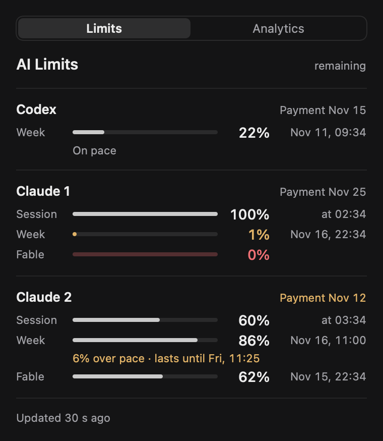
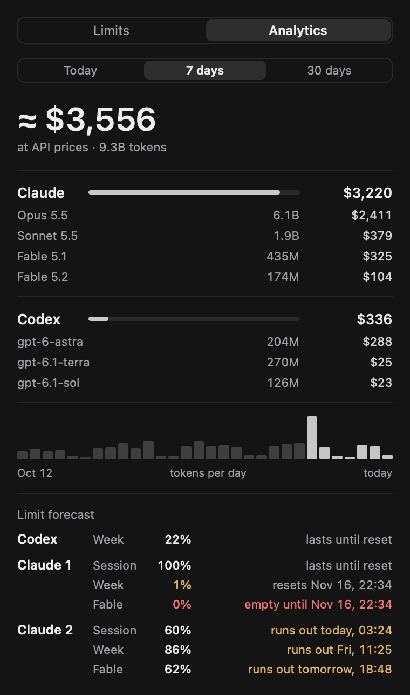
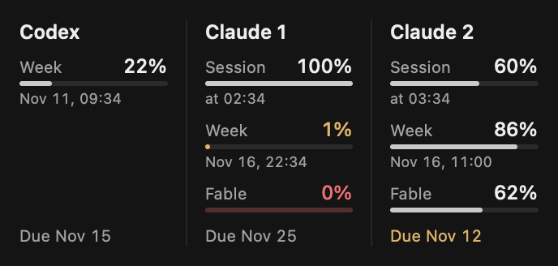
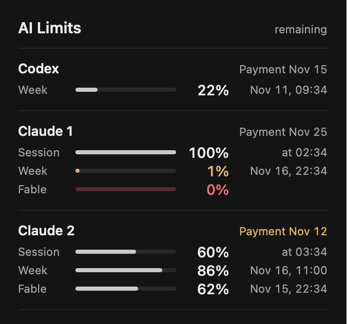
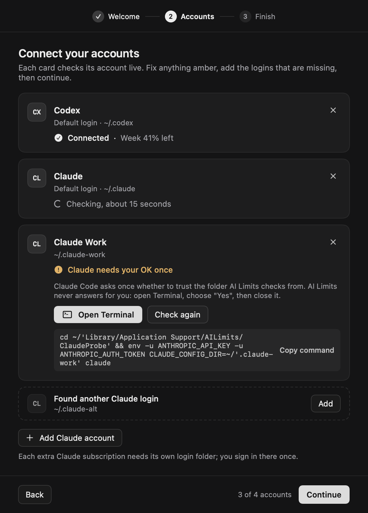

# AI Limits

[Русская версия](README.ru.md)

AI Limits is a small macOS menu bar app with a WidgetKit widget that shows how much of your Claude Code and OpenAI Codex subscription limits is left: the session and weekly windows, per-model weekly windows, when each one resets, whether you are on pace, and when the next payment is due. It also adds up token usage from the local CLI logs and estimates what that usage would cost at public API prices. It gets the limits by running your own `claude` and `codex` command line tools; it does not read tokens or credentials and does not talk to any AI service itself.

<p>
  
  
</p>

<p>
  
  
</p>

Screenshots are rendered from fixture data, not from a real account.

## Features

- Remaining limits for up to 8 accounts, any mix of Claude and Codex logins: session, week, and per-model weekly windows such as a model-only limit, each with its reset time. Percentages are what is **left**; a dash means "no data", not zero.
- The plan and login email of each account under its name ("Claude Max · you@example.com"), so "Claude 1" and "Claude 2" are easy to tell apart, and a warning when two accounts are signed into the same login. "Hide Emails" in the icon menu masks them as `y•••@example.com`. See [Login emails](#login-emails).
- Pace line under each weekly bar: "On pace", "N% under pace" or "N% over pace", plus "lasts until ..." when the current rate would empty the limit before it resets.
- Limit forecast on the Analytics tab for every window: lasts until reset, runs out at a given time, or empty until the reset.
- Next payment date: read automatically for Claude, set by hand in `billing.json` for anything else.
- Token analytics from the local Claude Code and Codex logs for Today, 7 days and 30 days: totals per provider and per model, and an estimated cost at public API prices.
- Bar chart of tokens per day for the last 30 days.
- Widget in medium and large sizes. Clicking it opens the app's floating panel.
- Floating panel that stays above other windows on every Space, in addition to the popover under the menu bar icon. It is shown on first launch; hide or show it with "Floating Panel" in the icon menu.
- Launch at login through the standard macOS login item mechanism.
- English and Russian interface.

## Requirements

- A Mac with Apple silicon running macOS 14 Sonoma or later. The build script produces an arm64-only app.
- Xcode 16 or later to build. The widget extension is built with `xcodebuild` against the full macOS SDK, so the Command Line Tools alone are not enough. You do not have to switch `xcode-select`: if it points to the Command Line Tools, `build.sh` uses `/Applications/Xcode.app`. Set `DEVELOPER_DIR` to use another Xcode.
- Claude Code (`claude`) and/or the Codex CLI (`codex`) installed and logged in.
- Plans that actually report usage limits: a Claude subscription whose `/usage` screen shows session and weekly limits, and a ChatGPT plan for which `codex` reports rate limits. API-key logins have no such limits to show.

## Install

```sh
git clone https://github.com/BLHN/ai-limits.git
cd ai-limits
./build.sh                 # builds into ./build and runs the self-test
scripts/install.sh         # copies "AI Limits.app" to ~/Applications and opens it
```

`build.sh` takes an optional build folder (`./build.sh /tmp/ai-limits-build`) and two environment variables:

| Variable | Default | Meaning |
| --- | --- | --- |
| `AI_LIMITS_BUNDLE_ID` | `local.ai-limits` | App bundle id. The widget gets `<id>.widget`. |
| `AI_LIMITS_SIGN_IDENTITY` | `-` (ad-hoc) | `codesign` identity. See [Signing and the widget](#signing-and-the-widget). |

`scripts/install.sh [build_dir]` asks a running copy to quit (it never force-kills it), replaces `~/Applications/AI Limits.app`, verifies the signature and opens the app.

### First run

1. Look for the gauge icon in the menu bar. Left-click opens the popover with the **Limits** and **Analytics** tabs. Right-click (or Control-click) opens the menu: Refresh Now, Accounts…, Update Prices, Floating Panel, Hide Emails, Launch at Login, Quit AI Limits. The app has no Dock icon. A small floating panel with the same limits also appears in the top-right corner of the screen and stays above other windows; turn it off with "Floating Panel" in the menu (the choice is remembered), or drag it where you want it.
2. On a fresh install the setup window opens by itself and walks you through connecting every account (see [Getting started](#getting-started)). Accounts are also detected automatically (see [Accounts](#accounts-configuration)). Codex numbers appear within a minute; each Claude login takes about 15 seconds per check (see [Refresh timing](#refresh-timing)). Until an account's first check succeeds it shows an amber "no data" and "No limits reported", and the footer says "Data delayed". If a check fails, the account shows a short reason in amber instead (hover it for details): "Run claude once in the probe folder — see README" (the trust step below), "Not logged in or no plan limits", "claude not found" / "codex not found", or "Check failed — run AILimits --check". For the full error, run `"$HOME/Applications/AI Limits.app/Contents/MacOS/AILimits" --check` in a terminal. If no CLI is found at all, the panel says "No accounts yet".
3. **Trust the Claude probe folder once.** The app runs `claude /usage` inside its own folder, `~/Library/Application Support/AILimits/ClaudeProbe`. If Claude Code asks whether you trust that folder, the app never answers for you: the check fails with "the probe folder is not trusted yet" and that account shows no data. Answer the prompt yourself once per Claude login. The setup window's **Open Terminal** button starts this session for you; by hand it is:

   ```sh
   mkdir -p ~/Library/Application\ Support/AILimits/ClaudeProbe
   cd ~/Library/Application\ Support/AILimits/ClaudeProbe
   claude                                   # default login: confirm the trust prompt, then /exit
   CLAUDE_CONFIG_DIR=~/.claude-work claude  # each extra login from accounts.json, same steps
   ```

   Depending on your Claude Code settings the prompt may not appear at all; then there is nothing to do.
4. **Add the widget.** Open the widget gallery (right-click the desktop, then Edit Widgets, or the Notification Center), search for AI Limits and add **All accounts** in the medium or large size. If it is not in the gallery, read [Signing and the widget](#signing-and-the-widget).
5. **Launch at login.** Turn on "Launch at Login" in the icon's menu. macOS may ask you to approve it in System Settings > General > Login Items.

## Getting started

On the first launch of a fresh install (no `accounts.json` and no history yet) AI Limits opens a short setup window. Open it again at any time with **Accounts…** in the menu bar icon's menu, with **Set up accounts** in an empty panel, or with **Fix** next to an account whose check failed.

<p></p>

1. **Welcome**: what the app does and what it never touches.
2. **Accounts**: one card per account (up to 8), each checked live by the app's normal check. The list starts with what is configured or detected, plus extra logins found in your home folder: folders named `.claude-something` that contain a `.claude.json` file, and folders named `.codex-something` that contain an `auth.json` file (only folder names and the file's existence are checked; neither file is opened). A card shows the plan and login email once the account has been checked, then "Connected · Week 83% left" or what is missing, with the button that fixes it:
   - CLI not installed: **Install guide** opens the official install page; then **I installed it, check again**.
   - Claude asks to trust the probe folder, or the login is not signed in: **Open Terminal** starts your own `claude` in the probe folder (with `CLAUDE_CONFIG_DIR` for an extra login), or `codex login`, and prints one line saying what to do. You answer the trust prompt or type `/login` yourself; the card re-checks by itself for up to 3 minutes. **Copy command** gives the same command for another terminal app. For the default logins the Terminal session and the copied command drop a `CLAUDE_CONFIG_DIR` or `CODEX_HOME` exported in your shell profile, so they sign in the same folder the app checks.
   - Any other failure: **Check again**, and the app's error text under **Details**.

   - Two cards signed into the same login (same email): the card with its own login folder says "Claude 1 and Claude 2 are the same login" (the default login is never the one asked to sign in again; if both have their own folders, the later card is). **Open Terminal** starts `claude` for that card's login folder so you can `/login` with the other account (for Codex, `codex login` with its `CODEX_HOME`).

   **Add Claude account** and **Add Codex account** add the default login of that type first; after that they ask for a short name and a separate login folder (`~/.claude-<name>` or `~/.codex-<name>`, editable), create the folder (mode 0700), and the new card then takes you through signing in there (`CODEX_HOME=<folder> codex login` for Codex). Names can be edited on the cards, and the arrows on each card change the order, which is also the order in the panel and the widget. Changes are written to `accounts.json` as you make them and again on **Continue**; an existing `cli` block and any keys the app does not know are kept.
3. **Finish**: Launch at login, the floating panel, Hide emails, and how to add the widget. **Done** closes the window; it does not open again by itself.

The Terminal scripts are written to `~/Library/Application Support/AILimits/Onboarding/`. They contain only fixed commands (`cd` to the probe folder, the login folder variable, one printed instruction and your CLI; never an email); AI Limits never types into Terminal. `--onboarding` opens the window at launch (useful for screenshots).

## Accounts configuration

Without a configuration file the app detects the installed CLIs:

- `codex` found: one Codex account, id `codex`, using the default Codex home.
- `claude` found: one Claude account, id `claude-1`, using the default login (`~/.claude`, no `CLAUDE_CONFIG_DIR`).

The CLIs are looked up in `~/.local/bin`, `/opt/homebrew/bin`, `/usr/local/bin`, `~/.npm-global/bin`, `~/.bun/bin`, `~/.volta/bin` and `~/.claude/local`, and then, if still not found, by asking your login shell (`$SHELL -lc 'command -v claude'`, 4 second limit). Without a file, detection is repeated every 5 minutes, so a CLI installed later into one of those folders shows up by itself. A path found by the login shell is remembered until the app quits; "not found" is remembered for 5 minutes only, so a CLI that is only reachable through your shell's `PATH` (for example under nvm) also shows up within a few minutes of installing it. You can always set its path under `cli` in `accounts.json`.

For several Claude or Codex logins, custom names or explicit CLI paths, create `~/Library/Application Support/AILimits/accounts.json`:

```json
{
  "accounts": [
    { "id": "codex", "type": "codex", "name": "Codex" },
    { "id": "codex-2", "type": "codex", "name": "Codex Work", "home": "~/.codex-work" },
    { "id": "claude-personal", "type": "claude", "name": "Claude" },
    { "id": "claude-work", "type": "claude", "name": "Claude Work", "configDir": "~/.claude-work" }
  ],
  "cli": {
    "claude": "~/.local/bin/claude",
    "codex": "/opt/homebrew/bin/codex"
  }
}
```

A copy without the `cli` block is in [examples/accounts.json](examples/accounts.json).

| Key | Required | Meaning |
| --- | --- | --- |
| `id` | yes | 1 to 32 characters from `a-z`, `0-9` and `-`, unique. It keys the history, `billing.json` and the cache, so keep it stable. |
| `type` | yes | `"claude"` or `"codex"`. |
| `name` | no | Label in the panel and widget, up to 32 characters. Defaults: `Codex`, `Claude`, or `Claude 1`, `Claude 2`, ... (`Codex 1`, `Codex 2`, ...) when there are several accounts of the type. |
| `configDir` | no, Claude only | Passed to `claude` as `CLAUDE_CONFIG_DIR`. Leave it out for the default login. This is how a second Claude login is added: log in once with `CLAUDE_CONFIG_DIR=~/.claude-work claude`, then list that folder here. |
| `home` | no, Codex only | Passed to `codex` as `CODEX_HOME`. Leave it out for the default. This is how a second Codex login is added: `CODEX_HOME=~/.codex-work codex login`, then list that folder here. Each Codex account needs its own home; only one may use the default. |
| `cli.claude`, `cli.codex` | no | Absolute path (or `~/...`) to the executable. Use it when the CLI is somewhere the app does not look. |

Rules:

- At most 8 accounts are shown; extra entries are dropped with a warning.
- Paths must be absolute or start with `~/`.
- Bad entries (wrong id, duplicate id, unknown type, a second Codex account with the default home or with a home another Codex account already uses, relative path, non-executable `cli` path) are skipped, and a short amber warning naming the problem appears in the panel.
- If the file is not valid JSON with an `accounts` list, or no entry is usable, the app falls back to auto-detection and shows a warning.
- Changes are picked up within a few seconds, without restarting the app. An account whose type or folder changed starts again with empty numbers.

Check what the app resolved with `AILimits --accounts` (see [Command line](#command-line)).

### Refresh timing

- **Codex:** every Codex account is checked about once a minute, independently of Claude; a check takes a second or two. At most two Codex checks run at the same time; the others wait for a free slot in list order.
- **Claude:** Claude checks run one at a time (never in parallel) and take about 15 seconds each. An account is due again 2 minutes after its last check, or `15 s × number of Claude accounts + 30 s` when that is longer, so a full round never runs back to back: up to 6 Claude accounts refresh about every 2 minutes, 7 about every 2¼ minutes, 8 about every 2½ minutes. "Refresh Now" queues every account at once; with 8 Claude accounts the last one updates about 2 minutes later.

## Login emails

Each account shows its plan and login email as a muted line under its name in the popover, the floating panel and the setup window (and in the name's tooltip on the Analytics forecast, and in the menu bar icon's tooltip). They come from two places only:

- **Claude:** `oauthAccount.emailAddress` and `oauthAccount.planDisplayName` in the login's `.claude.json`, the same file and the same parse as the payment date.
- **Codex:** the `account/read` request (`result.account.email` and `result.account.planType`) sent to `codex app-server` in the same session that already reads the rate limits. If it fails, the limits are still shown. An API-key login has no email or plan to show.

Emails are kept in memory only: they are never written to any file (the widget snapshot, history, caches, `accounts.json`, the Terminal scripts), never logged and never sent anywhere. The widget shows names only. `AILimits --accounts` prints a Claude login's email masked.

**Hide Emails** in the icon menu (also on the setup window's Finish step) shows every email as `y•••@example.com`: first character, three bullets, domain. It is remembered in the app's preferences (`hideEmails`).

If two accounts of the same type report the same email, the panel shows "Claude 1 and Claude 2 are the same login" with a **Fix** link that opens the setup window on the account with its own login folder (the later one when both have one), where **Open Terminal** lets you sign that login folder into your other account.

## Payment dates

The next payment is shown as "Payment Nov 15" in the panel and "Due Nov 15" in the widget, and turns amber when it is 3 days away or less. It is computed as a monthly recurrence on the day of the month of an anchor date (clamped to shorter months).

- **Claude:** the anchor is read automatically from `oauthAccount.subscriptionCreatedAt` in the login's `.claude.json` (`~/.claude.json` for the default login, `<configDir>/.claude.json` otherwise). No other field of that file is used.
- **Codex and everything else:** add the date by hand in `~/Library/Application Support/AILimits/billing.json`, keyed by account id. A date in this file also overrides the automatic Claude date.

```json
{
  "codex": "2026-01-15",
  "claude-work": "2026-03-03T10:00:00Z"
}
```

Values are either `YYYY-MM-DD` or an ISO 8601 timestamp (converted to the system time zone). Keys that are not valid account ids and values that do not parse are ignored. Edits apply within a few seconds. Example: [examples/billing.json](examples/billing.json).

## Analytics and prices

The Analytics tab reads the logs the CLIs already write on your Mac:

- Claude Code: `*.jsonl` files under `<configDir or ~/.claude>/projects/` for every configured Claude account (a shared folder is counted once). Assistant messages with a `usage` block are counted, duplicates (same message id and request id) are counted once, and the `<synthetic>` model is skipped.
- Codex: `*.jsonl` files under `<home or $CODEX_HOME or ~/.codex>/sessions/`, using the token usage records (or `token_count` events in files that have no such records).

Only files changed in the last 31 days are read. From each line the app takes the timestamp, the model name and the token counters (input, cache write, cache read, output); message ids are kept only as 64-bit hashes for deduplication. Days follow the system time zone. The first scan of a large log folder can take a while; later scans read only what was appended. Results are cached in `usage-cache.json` (plus `usage-cache.seen` with the dedupe hashes). The logs are rescanned every 5 minutes.

**Costs are estimates.** They multiply your token counts by public pay-as-you-go API list prices. They are not your bill and say nothing about what a subscription costs; they are a way to compare usage between models and days. A model without a known price is listed and left out of the total.

Prices come from three layers, highest priority first, matched by the longest key that is a prefix of the model name in the log:

1. `prices.json`: your own overrides (optional).
2. `prices-auto.json`: downloaded by the app.
3. A built-in table compiled into the app, checked on 2026-11-10.

Automatic update: once an hour the app checks whether the downloaded prices are missing or older than 7 days and, if so, downloads two public pages:

- `https://platform.claude.com/docs/en/about-claude/pricing.md`
- `https://developers.openai.com/api/docs/pricing.md`

If a model with tokens in the last 30 days has no price, it tries again at most once per 24 hours. A page whose table cannot be parsed or fails sanity checks is rejected and the previous prices stay. To update by hand, use "Update Prices" in the icon menu or `AILimits --update-prices`.

`prices.json` format, USD per million tokens (missing fields are 0, except `cacheWrite1h`, which defaults to `cacheWrite`):

```json
{
  "claude-opus-5-5": { "input": 4, "cacheWrite": 5, "cacheWrite1h": 8, "cacheRead": 0.2, "output": 20 }
}
```

## Language

The interface is English, or Russian when Russian is the first preferred language in System Settings. To override it for the app:

```sh
defaults write local.ai-limits language ru    # or en; use your bundle id if you changed it
defaults delete local.ai-limits language      # back to the system language
```

The environment variable `AI_LIMITS_LANG=en|ru` takes precedence over that setting (useful from a terminal). The widget always follows the system language. Command line reports are always in English.

## Command line

The app binary is `~/Applications/AI Limits.app/Contents/MacOS/AILimits`.

| Command | What it does |
| --- | --- |
| `AILimits --self-test` | Runs the built-in tests on fixture data (no CLIs, no network). `build.sh` runs it on every build. |
| `AILimits --accounts` | Prints the resolved accounts, where each CLI was found, a Claude login's email (masked) and plan, and any `accounts.json` warning. Does not run the CLIs. |
| `AILimits --check` | Fetches every account live once by running the real `claude` and `codex` CLIs and prints the result (about 15 seconds per Claude account). |
| `AILimits --analytics [--no-cache]` | Scans the logs and prints token totals, per-model counts and estimated costs. `--no-cache` scans everything without reading or writing the cache. |
| `AILimits --prices` | Prints the merged price table with the source of each entry and the download dates. |
| `AILimits --update-prices` | Downloads and validates the two pricing pages now and writes `prices-auto.json`. |
| `AILimits --launch-at-login [enable\|disable\|status]` | Turns the login item on or off, or prints its status (default `status`). |
| `AILimits --onboarding` | Starts the menu bar app and opens the setup window. |

Without a flag the binary starts the menu bar app.

## Privacy and security

What the app reads:

- `accounts.json`, `billing.json` and `prices.json` in `~/Library/Application Support/AILimits/`, if you create them.
- While the setup window is open: the names of the folders in your home folder, to suggest extra logins, and whether such a folder contains a `.claude.json` or `auth.json` file (neither file is opened).
- Each Claude login's `.claude.json`: the file is read and parsed in memory, and only `oauthAccount.subscriptionCreatedAt`, `oauthAccount.emailAddress` and `oauthAccount.planDisplayName` are kept; everything else in it is discarded without being logged or stored. The email and plan are kept in memory only.
- The Claude Code and Codex `*.jsonl` logs listed above: only timestamps, model names, token counters and message ids (hashed). Conversation text, prompts, file contents and working directories are not decoded or stored.

What it runs:

- `codex app-server` (with `CODEX_HOME` for an account that has `home`), talking to it over stdin/stdout with four JSON-RPC messages (`initialize`, `initialized`, `account/rateLimits/read`, `account/read`), then stopping it. About once a minute per Codex account. From `account/read` only the login email and plan type are taken, in memory.
- `claude /usage` in a pseudo-terminal, in the folder `~/Library/Application Support/AILimits/ClaudeProbe`, with all `CLAUDE*` and `ANTHROPIC*` environment variables removed (and `CLAUDE_CONFIG_DIR` set only for an account that has `configDir`). The app sends no keystrokes to Claude (so it never answers the folder trust prompt); it only resizes the terminal once to get a fresh repaint, parses the screen text and stops the process. Claude logins are checked one after another, about every 2 minutes (see [Refresh timing](#refresh-timing)).
- Your login shell, only to find a CLI that is not in the usual folders (`command -v <name>`).
- Terminal, only when you click **Open Terminal** in the setup window: a `.command` script with fixed content that starts your `claude` or `codex login`. The app sends nothing to it.

These CLIs contact their own services the way they always do when you run them; the app adds no requests of its own to those services and sends no model requests.

What it never reads: API keys, OAuth tokens, other credentials, the macOS keychain or any Codex `auth.json` (it only checks whether one exists, to suggest a login folder). Login emails and plan names (see [Login emails](#login-emails)) are shown in the app's own windows and tooltips only; they and other identifiers from the services (user or organization ids) are never logged, written to its files or sent anywhere. The only ids it stores are the account ids you choose in `accounts.json` (or `codex` and `claude-1` when detected).

What it writes, all under `~/Library/Application Support/AILimits/` (every file is created readable only by you, mode 0600; the folder is 0700 when the app creates it, but not if you created it yourself first):

- `widget-snapshot.json`: account ids, names, remaining percentages, reset times and the payment anchor (no emails or plans). This is all the widget can see.
- `history.jsonl`: account id, time and remaining percentages, kept 30 days.
- `usage-cache.json` and `usage-cache.seen`: token counts per day and model, hashed file paths and message ids, and the system time zone name (the cache is rebuilt when the zone changes).
- `prices-auto.json`: the downloaded prices.
- the empty `ClaudeProbe` folder.
- `accounts.json`, when you change accounts in the setup window (a previous file that is not valid JSON is kept as `accounts.json.bak`).
- `Onboarding/`: the Terminal scripts of the setup window (`claude-<id>.command`, `codex.command`, `codex-2.command`, ..., mode 0700).
- An extra login folder you add in the setup window (for example `~/.claude-work` or `~/.codex-work`, mode 0700) is created in your home folder; Claude Code or Codex fills it when you sign in.

Network: the only network code in the app is the price update: an anonymous HTTPS GET of the two pricing pages above, with an ephemeral session (no cookies, no cache, no credentials), a fixed User-Agent `AILimits/<version>`, a 20 second timeout, a 2 MB size cap, and redirects to other hosts refused. Nothing derived from your data is sent.

The widget extension is sandboxed and has read-only access to `widget-snapshot.json` and nothing else.

## Signing and the widget

By default `build.sh` signs ad-hoc (`-`). That is enough for the menu bar app. macOS may refuse to load an ad-hoc-signed widget extension, in which case AI Limits does not appear in the widget gallery. This has not been verified either way on every macOS version, so if the widget is missing, sign with an Apple Development certificate:

1. Get a certificate. A free Apple ID works: in Xcode open Settings > Accounts, add your Apple ID (this creates a Personal Team), select the team, click Manage Certificates and add an Apple Development certificate.
2. Find the identity name:

   ```sh
   security find-identity -v -p codesigning
   ```

   It looks like `Apple Development: you@example.com (ABCDE12345)`.
3. Build and install with it:

   ```sh
   AI_LIMITS_SIGN_IDENTITY="Apple Development: you@example.com (ABCDE12345)" ./build.sh
   scripts/install.sh
   ```

If you change `AI_LIMITS_BUNDLE_ID`, pick an id that is yours (for example `com.yourname.ai-limits`).

## Troubleshooting

**"claude CLI not found" / "codex CLI not found", or an account is missing.** Run `AILimits --accounts`. A GUI app starts with a minimal `PATH`, so the app searches the usual folders and then asks your login shell. If your CLI lives elsewhere, or your shell profile prints something unusual, set the path in `accounts.json` under `cli`.

**An account shows "no data" and an amber reason, or "No limits reported".** The account block shows a short reason for a failed check (hover it for the fix); with older numbers still on screen it appears under the account name. `AILimits --check` in a terminal prints the full error, one line per account.
- "the probe folder is not trusted yet": do the one-time trust step from [First run](#first-run) for that login (with its `CLAUDE_CONFIG_DIR` if it has `configDir`).
- `no "Current session" or "Current week" section in /usage output`: Claude Code is not logged in, is showing its first-run setup, or the plan has no usage limits. Run `claude` in the probe folder (as in the trust step), finish the setup, and check that `/usage` shows the limits.
- "app-server returned an error" or "no rate-limit windows reported" for Codex: usually `codex` is not logged in, or is logged in with an API key. Run `codex` and sign in with your ChatGPT account.
- "claude CLI not found" or "codex CLI not found": see the previous item.

**"Data delayed" or an amber age.** A measurement older than 3 minutes shows its age in amber; when the latest check of every account failed, the footer says "Data delayed". The last good numbers are kept with their original time. Causes: the CLI is not logged in, needs an update, changed its output, or the machine was asleep. Use "Refresh Now" in the menu, and run `AILimits --check` in a terminal to see the error per account.

**Codex shows only a weekly limit.** Codex does not always report a session window; the app shows what it gets.

**The widget is not in the gallery or does not update.**
- Sign with an Apple Development identity (see above), rebuild, reinstall, and open the app once.
- Make sure there is only one copy of AI Limits installed, so macOS registers the right extension.
- Log out and back in, or restart, so the widget list is rebuilt.
- To check whether macOS registered the extension: `pluginkit -m -v -i local.ai-limits.widget` (use your bundle id + `.widget`).
- Stuck on old numbers after an update: an old widget process may still be running the previous build. `scripts/install.sh` stops it; after a manual install run `pkill -f AILimitsWidget.appex` once.
- The widget shows what the app last published; macOS decides when widgets refresh, so it can lag the popover by a few minutes. The app must be running.

**Costs look wrong or a model shows no price.** Run `AILimits --prices` and `AILimits --update-prices`, or add the model to `prices.json`.

## Uninstall

1. Turn off "Launch at Login" in the icon menu (or run `"$HOME/Applications/AI Limits.app/Contents/MacOS/AILimits" --launch-at-login disable`), and remove the widget from the desktop.
2. Quit AI Limits from its menu.
3. Delete the app and its data:

   ```sh
   rm -rf ~/Applications/AI\ Limits.app
   rm -rf ~/Library/Application\ Support/AILimits   # includes the Onboarding scripts
   defaults delete local.ai-limits 2>/dev/null   # app preferences; use your bundle id if you changed it
   ```

4. Optional leftovers:
   - macOS keeps the widget extension's sandbox container, `~/Library/Containers/local.ai-limits.widget` (your bundle id + `.widget`). AI Limits keeps none of its files there; delete it in Finder if you like (macOS may ask for permission).
   - Extra login folders such as `~/.claude-work` or `~/.codex-work` belong to Claude Code and Codex and stay; delete one only if you no longer use that login.
   - Claude Code remembers that you trusted the `ClaudeProbe` folder in its own settings (`.claude.json` of each login). AI Limits does not edit that file; the entry is harmless once the folder is gone.
   - If you ever turned on Launch at Login while running the app from the `build` folder, the login item points there. Turn it off with that copy (`"build/AI Limits.app/Contents/MacOS/AILimits" --launch-at-login disable`) or remove it in System Settings > General > Login Items.

The CLI logs and the Claude/Codex logins are not touched by uninstalling.

## Project layout

```
build.sh                       build the app and the widget, run the self-test, sign
scripts/install.sh             copy the built app to ~/Applications and open it
Sources/Shared/                code used by both the app and the widget
  Shared.swift                 snapshot format, accounts, quotas, payment dates, pace
  SummaryView.swift            limits view shared by the panel and the widget
  L10n.swift                   English/Russian strings and language choice
Sources/App/                   menu bar app (host)
  AILimits.swift               app delegate, scheduling, menu, CLI flags, self-test
  Onboarding.swift             setup window: welcome, account cards with fixes, finish
  Accounts.swift               accounts.json, auto-detection, CLI lookup
  Fetchers.swift               codex app-server and claude /usage fetchers, billing.json
  Analytics.swift              log scanner, usage cache, totals
  Prices.swift                 price tables, download and validation
  History.swift                history.jsonl
  PopoverView.swift            popover with the Limits and Analytics tabs
Sources/Widget/Widget.swift    WidgetKit extension
AILimitsWidget.xcodeproj       Xcode project for the widget extension only
Resources/                     Info.plist files and the widget entitlements
tools/preview/                 renders the views to PNG from fixture data
examples/                      sample accounts.json and billing.json
docs/screenshots/              images used in this README
```

## Development

- Build: `./build.sh [build_dir]`. The host binary is compiled directly with `swiftc` from every file in `Sources/Shared` and `Sources/App`; the widget is built from `AILimitsWidget.xcodeproj` with `xcodebuild`. Both target macOS 14 on arm64.
- Tests: `build.sh` runs `AILimits --self-test`, which covers the `/usage` and Codex parsers (including `account/read`), login emails (masking, same-login detection, never published), `accounts.json` handling and writing (8 accounts, several Codex homes), widget layouts for 5-8 accounts, `AI_LIMITS_DATA_DIR`, login discovery and Terminal script quoting, payment dates, pace, history, the log scanner on synthetic files and the price page parsers. Run it in Russian too: `AI_LIMITS_LANG=ru build/AILimits --self-test`.
- Previews: `tools/preview/render.sh [out_dir]` renders the widget sizes, the floating panel, both popover tabs and the setup window steps (`onboarding-*.png`) from fixture data to PNG, without running the app. `AI_LIMITS_LANG=en|ru` picks the language.
- Adding a file to `Sources/Shared`: the host build picks it up automatically, but the widget target lists its files explicitly. Add it to `AILimitsWidget.xcodeproj` (a `PBXFileReference`, a `PBXBuildFile` and an entry in the widget target's Sources build phase), or open the project in Xcode and tick the AILimitsWidget target for the file.
- Environment variables for testing: `AI_LIMITS_DATA_DIR` (absolute or `~/...`: another data folder instead of `~/Library/Application Support/AILimits` for `accounts.json`, `billing.json`, `prices.json`, `prices-auto.json`, `history.jsonl`, the usage cache, `widget-snapshot.json`, the `ClaudeProbe` folder and the `Onboarding` scripts, for isolated test runs; the widget always reads the default folder, so it does not see a test run. Any other value, such as a relative path, stops the app with an error instead of falling back to the real folder. A test run also keeps its own preferences (setup done, Hide Emails, Floating Panel, panel position) in a separate `local.ai-limits.test-<hash>` domain and never changes Launch at Login), `AI_LIMITS_PROBE_DIR` (another folder for the Claude probe), `AI_LIMITS_USAGE_CACHE` (another cache path), `AI_LIMITS_PRICES_AUTO` (another `prices-auto.json` path), `AI_LIMITS_LANG`. The three specific paths win over `AI_LIMITS_DATA_DIR`. Example: `AI_LIMITS_DATA_DIR=/tmp/ail-test "build/AI Limits.app/Contents/MacOS/AILimits" --accounts`.
- `AILimits --check` runs the real CLIs against your real accounts; it is not part of the automated build.

## License

MIT, see [LICENSE](LICENSE).

## Disclaimer

AI Limits is an unofficial project and is not affiliated with, endorsed by or supported by Anthropic or OpenAI. "Claude", "Claude Code", "Codex" and "ChatGPT" are trademarks of their owners. The app works by reading the output of the `claude` and `codex` CLIs and the format of their local logs and of the public pricing pages. Any of these can change without notice, and the numbers may then be missing or wrong until the app is updated. Cost figures are estimates, not billing data.
