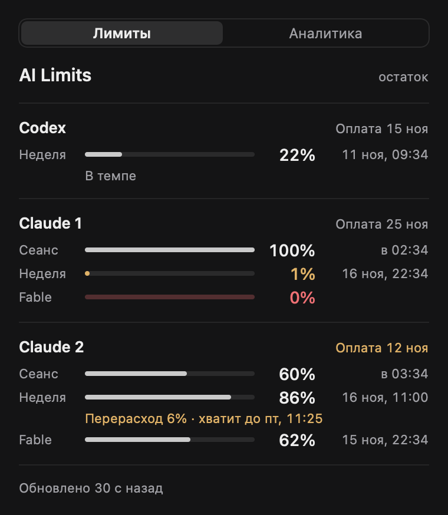
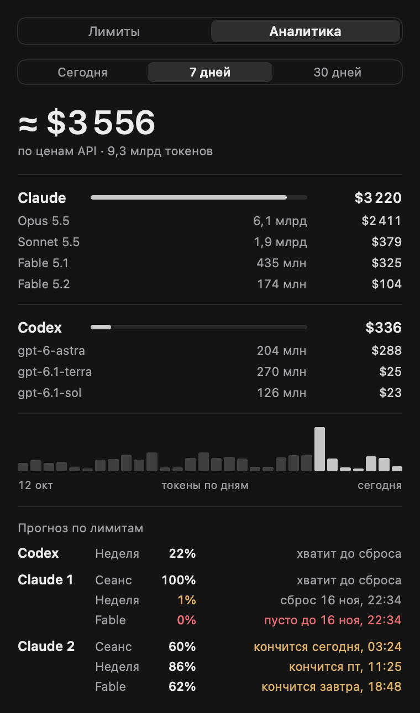

# AI Limits

[English version](README.md)

AI Limits — небольшое приложение для строки меню macOS с виджетом WidgetKit. Оно показывает, сколько осталось от лимитов подписки Claude Code и OpenAI Codex: сеансовое и недельное окно, недельные окна по отдельным моделям, время сброса каждого, укладываетесь ли вы в темп и когда следующая оплата. Кроме того, приложение считает токены по локальным логам CLI и прикидывает, сколько такой расход стоил бы по публичным ценам API. Лимиты оно получает, запуская ваши собственные `claude` и `codex`; токены и учётные данные не читает и само ни к каким AI-сервисам не обращается.

<p>
  
  
</p>

Снимки отрисованы на тестовых данных, это не реальный аккаунт. Снимки виджета на английском — в [README.md](README.md).

## Возможности

- Остаток лимитов для 4 аккаунтов максимум (один Codex и сколько угодно входов Claude в пределах этого числа): сеанс, неделя и недельные окна по моделям, у каждого время сброса. Проценты — это **остаток**; прочерк значит «нет данных», а не ноль.
- Строка темпа под недельной шкалой: «В темпе», «Запас N%» или «Перерасход N%», и «хватит до ...», если при нынешней скорости лимит кончится раньше сброса.
- Прогноз по каждому окну на вкладке «Аналитика»: хватит до сброса, кончится в такое-то время или пусто до сброса.
- Дата следующей оплаты: для Claude определяется сама, для остального задаётся вручную в `billing.json`.
- Аналитика токенов по локальным логам Claude Code и Codex за сегодня, 7 и 30 дней: итоги по провайдерам и моделям и оценка стоимости по ценам API.
- Столбики токенов по дням за последние 30 дней.
- Виджет среднего и большого размера. Нажатие на него открывает плавающую панель приложения.
- Плавающая панель поверх остальных окон на всех рабочих столах — в дополнение к окну под иконкой в строке меню. При первом запуске она показана; скрыть или показать её можно пунктом «Плавающая панель» в меню иконки.
- Запуск при входе в систему штатным механизмом macOS.
- Интерфейс на английском и русском.

## Что нужно

- Mac на Apple silicon с macOS 14 Sonoma или новее. Скрипт сборки собирает только arm64.
- Xcode 16 или новее для сборки. Расширение виджета собирается через `xcodebuild` с полным macOS SDK, одних Command Line Tools не хватит. Переключать `xcode-select` не обязательно: если он указывает на Command Line Tools, `build.sh` возьмёт `/Applications/Xcode.app`. Другой Xcode можно указать через `DEVELOPER_DIR`.
- Установленные Claude Code (`claude`) и/или Codex CLI (`codex`), в которых выполнен вход.
- Тарифы, у которых вообще есть лимиты: подписка Claude, где экран `/usage` показывает сеансовый и недельный лимиты, и тариф ChatGPT, для которого `codex` отдаёт лимиты. У входа по API-ключу таких лимитов нет.

## Установка

```sh
git clone https://github.com/BLHN/ai-limits.git
cd ai-limits
./build.sh                 # собирает в ./build и прогоняет самотест
scripts/install.sh         # копирует «AI Limits.app» в ~/Applications и запускает
```

`build.sh` принимает папку сборки (`./build.sh /tmp/ai-limits-build`) и две переменные окружения:

| Переменная | По умолчанию | Что задаёт |
| --- | --- | --- |
| `AI_LIMITS_BUNDLE_ID` | `local.ai-limits` | Bundle id приложения. У виджета будет `<id>.widget`. |
| `AI_LIMITS_SIGN_IDENTITY` | `-` (ad-hoc) | Идентичность для `codesign`. См. [Подпись и виджет](#подпись-и-виджет). |

`scripts/install.sh [build_dir]` просит запущенную копию завершиться (принудительно не убивает), заменяет `~/Applications/AI Limits.app`, проверяет подпись и запускает приложение.

### Первый запуск

1. В строке меню появится иконка-шкала. Левый клик открывает окно с вкладками **«Лимиты»** и **«Аналитика»**. Правый клик (или Ctrl-клик) — меню: «Обновить сейчас», «Обновить цены», «Плавающая панель», «Запускать при входе», «Закрыть AI Limits». В Dock приложения нет. В правом верхнем углу экрана также появится небольшая плавающая панель с теми же лимитами, которая держится поверх остальных окон; её можно перетащить или выключить пунктом «Плавающая панель» в меню (выбор запоминается).
2. Аккаунты находятся сами (см. [Аккаунты](#настройка-аккаунтов)). Codex появится в течение минуты, проверка каждого входа Claude занимает около 15 секунд. Пока первая проверка аккаунта не прошла, у него янтарное «нет данных» и «Сервис не передал лимиты», а внизу написано «Данные задерживаются». Если проверка не прошла, у аккаунта вместо этого янтарным написана короткая причина (подробности во всплывающей подсказке): «Запустите claude в папке проверки — см. README» (шаг с доверием ниже), «Нет входа или у тарифа нет лимитов», «claude не найден» / «codex не найден» или «Проверка не удалась — запустите AILimits --check». Полную ошибку покажет `"$HOME/Applications/AI Limits.app/Contents/MacOS/AILimits" --check` в терминале. Если не найден ни один CLI, панель пишет «Аккаунтов пока нет».
3. **Один раз подтвердите доверие к папке Claude.** Приложение запускает `claude /usage` в своей папке `~/Library/Application Support/AILimits/ClaudeProbe`. Если Claude Code спросит, доверяете ли вы этой папке, приложение не ответит за вас: проверка завершится ошибкой «the probe folder is not trusted yet», и у аккаунта не будет данных. Ответьте сами, один раз для каждого входа Claude:

   ```sh
   mkdir -p ~/Library/Application\ Support/AILimits/ClaudeProbe
   cd ~/Library/Application\ Support/AILimits/ClaudeProbe
   claude                                   # обычный вход: подтвердите доверие, затем /exit
   CLAUDE_CONFIG_DIR=~/.claude-work claude  # каждый дополнительный вход из accounts.json — так же
   ```

   При некоторых настройках Claude Code вопрос не появляется вовсе; тогда делать ничего не нужно.
4. **Добавьте виджет.** Откройте галерею виджетов (правый клик по рабочему столу → «Изменить виджеты» или Центр уведомлений), найдите AI Limits и добавьте **«Все аккаунты»** среднего или большого размера. Если его там нет, см. [Подпись и виджет](#подпись-и-виджет).
5. **Запуск при входе.** Включите «Запускать при входе» в меню иконки. macOS может попросить подтвердить это в Системных настройках → Основные → Объекты входа.

## Настройка аккаунтов

Без файла настроек приложение ищет установленные CLI:

- нашёлся `codex` — один аккаунт Codex с id `codex` и стандартной папкой Codex;
- нашёлся `claude` — один аккаунт Claude с id `claude-1` и обычным входом (`~/.claude`, без `CLAUDE_CONFIG_DIR`).

CLI ищутся в `~/.local/bin`, `/opt/homebrew/bin`, `/usr/local/bin`, `~/.npm-global/bin`, `~/.bun/bin`, `~/.volta/bin` и `~/.claude/local`, а если не нашлись — приложение спрашивает login shell (`$SHELL -lc 'command -v claude'`, не дольше 4 секунд). Пока файла нет, поиск повторяется раз в 5 минут, так что CLI, установленный позже в одну из этих папок, подхватится сам. Найденный через login shell путь запоминается до выхода из приложения, а «не найдено» — только на 5 минут, так что CLI, доступный лишь через `PATH` вашей оболочки (например, через nvm), тоже появится через несколько минут после установки. Путь всегда можно указать в блоке `cli` файла `accounts.json`.

Чтобы добавить несколько входов Claude, задать свои названия или явные пути к CLI, создайте `~/Library/Application Support/AILimits/accounts.json`:

```json
{
  "accounts": [
    { "id": "codex", "type": "codex", "name": "Codex" },
    { "id": "claude-personal", "type": "claude", "name": "Claude" },
    { "id": "claude-work", "type": "claude", "name": "Claude Work", "configDir": "~/.claude-work" }
  ],
  "cli": {
    "claude": "~/.local/bin/claude",
    "codex": "/opt/homebrew/bin/codex"
  }
}
```

Тот же пример без блока `cli` лежит в [examples/accounts.json](examples/accounts.json).

| Ключ | Обязателен | Значение |
| --- | --- | --- |
| `id` | да | От 1 до 32 символов из `a-z`, `0-9` и `-`, без повторов. По нему хранятся история, записи в `billing.json` и кэш, поэтому лучше его не менять. |
| `type` | да | `"claude"` или `"codex"`. Аккаунт `codex` может быть только один. |
| `name` | нет | Подпись в панели и виджете, до 32 символов. По умолчанию `Codex`, `Claude` или `Claude 1`, `Claude 2`, ..., если аккаунтов Claude несколько. |
| `configDir` | нет, только Claude | Передаётся в `claude` как `CLAUDE_CONFIG_DIR`. Для обычного входа не указывайте. Так добавляется второй вход Claude: войдите один раз через `CLAUDE_CONFIG_DIR=~/.claude-work claude`, затем укажите эту папку здесь. |
| `home` | нет, только Codex | Передаётся в `codex` как `CODEX_HOME`. По умолчанию не нужен. |
| `cli.claude`, `cli.codex` | нет | Абсолютный путь (или `~/...`) к исполняемому файлу — если CLI лежит там, где приложение его не ищет. |

Правила:

- Показывается не больше 4 аккаунтов; лишние записи отбрасываются с предупреждением.
- Пути должны быть абсолютными или начинаться с `~/`.
- Неправильные записи (плохой или повторный id, неизвестный type, второй Codex, относительный путь, неисполняемый путь в `cli`) пропускаются, а в панели появляется короткое янтарное предупреждение с причиной.
- Если файл — не JSON со списком `accounts` или в нём нет ни одной годной записи, приложение переходит к автопоиску и показывает предупреждение.
- Изменения применяются за несколько секунд, перезапуск не нужен. Если у аккаунта поменялся тип или папка, его данные начинаются заново.

Что в итоге получилось, показывает `AILimits --accounts` (см. [Командная строка](#командная-строка)).

## Даты оплаты

Следующая оплата показывается как «Оплата 15 ноя» в панели и «Оплата 15.11» в виджете и становится янтарной, когда до неё 3 дня или меньше. Дата считается как ежемесячный повтор числа из опорной даты (в коротких месяцах — последний день).

- **Claude:** опорная дата берётся сама из `oauthAccount.subscriptionCreatedAt` в `.claude.json` этого входа (`~/.claude.json` для обычного входа, `<configDir>/.claude.json` для остальных). Другие поля этого файла не читаются.
- **Codex и всё остальное:** укажите дату вручную в `~/Library/Application Support/AILimits/billing.json`, ключ — id аккаунта. Дата из этого файла важнее автоматической даты Claude.

```json
{
  "codex": "2026-01-15",
  "claude-work": "2026-03-03T10:00:00Z"
}
```

Значение — `ГГГГ-ММ-ДД` или метка времени ISO 8601 (переводится в системный часовой пояс). Ключи, которые не годятся как id, и нераспознанные значения пропускаются. Правки применяются за несколько секунд. Пример: [examples/billing.json](examples/billing.json).

## Аналитика и цены

Вкладка «Аналитика» читает логи, которые CLI и так пишут на вашем Mac:

- Claude Code: файлы `*.jsonl` в `<configDir или ~/.claude>/projects/` для каждого настроенного аккаунта Claude (общая папка считается один раз). Учитываются ответы ассистента с блоком `usage`, повторы (тот же id сообщения и запроса) считаются один раз, модель `<synthetic>` пропускается.
- Codex: файлы `*.jsonl` в `<home или $CODEX_HOME или ~/.codex>/sessions/`, по записям о расходе токенов (или по событиям `token_count` в файлах, где таких записей нет).

Читаются только файлы, изменённые за последние 31 день. Из каждой строки берутся время, название модели и счётчики токенов (вход, запись в кэш, чтение из кэша, выход); id сообщений хранятся только как 64-битные хеши для отсева повторов. Дни считаются по системному часовому поясу. Первый проход по большой папке логов может занять время, дальше читается только дописанное. Результат кэшируется в `usage-cache.json` (и `usage-cache.seen` с хешами). Логи перечитываются раз в 5 минут.

**Стоимость — это оценка.** Она получается умножением ваших токенов на публичные цены API с оплатой за использование. Это не ваш счёт и не цена подписки — просто способ сравнить расход между моделями и днями. Модель без известной цены отмечается отдельно и в сумму не входит.

Цены берутся из трёх слоёв, по убыванию приоритета; для модели из лога выбирается самый длинный ключ, который является её префиксом:

1. `prices.json` — ваши правки (необязательно).
2. `prices-auto.json` — скачанное приложением.
3. Встроенная таблица, сверенная 2026-11-10.

Автообновление: раз в час приложение проверяет, нет ли скачанных цен или не старше ли они 7 дней, и если так — скачивает две публичные страницы:

- `https://platform.claude.com/docs/en/about-claude/pricing.md`
- `https://developers.openai.com/api/docs/pricing.md`

Если у модели с токенами за последние 30 дней нет цены, внеочередная попытка делается не чаще раза в сутки. Страница, таблицу которой не удалось разобрать или которая не прошла проверки, отбрасывается, остаются прежние цены. Обновить вручную — пункт «Обновить цены» в меню иконки или `AILimits --update-prices`.

Формат `prices.json`, доллары за миллион токенов (отсутствующие поля — 0, кроме `cacheWrite1h`, который по умолчанию равен `cacheWrite`):

```json
{
  "claude-opus-5-5": { "input": 4, "cacheWrite": 5, "cacheWrite1h": 8, "cacheRead": 0.2, "output": 20 }
}
```

## Язык

Интерфейс английский, а если первым предпочитаемым языком в Системных настройках стоит русский — русский. Переопределить для приложения:

```sh
defaults write local.ai-limits language ru    # или en; если меняли bundle id — укажите свой
defaults delete local.ai-limits language      # снова как в системе
```

Переменная окружения `AI_LIMITS_LANG=en|ru` важнее этой настройки (удобно из терминала). Виджет всегда следует языку системы. Отчёты командной строки всегда на английском.

## Командная строка

Исполняемый файл: `~/Applications/AI Limits.app/Contents/MacOS/AILimits`.

| Команда | Что делает |
| --- | --- |
| `AILimits --self-test` | Встроенные тесты на тестовых данных (без CLI и сети). `build.sh` запускает их при каждой сборке. |
| `AILimits --accounts` | Показывает найденные аккаунты, где нашёлся каждый CLI, и предупреждения по `accounts.json`. CLI не запускает. |
| `AILimits --check` | Один живой опрос всех аккаунтов через настоящие `claude` и `codex` с выводом результата (около 15 секунд на каждый Claude). |
| `AILimits --analytics [--no-cache]` | Проходит по логам и печатает итоги токенов, счётчики по моделям и оценку стоимости. С `--no-cache` читает всё заново, кэш не читает и не пишет. |
| `AILimits --prices` | Печатает итоговую таблицу цен с источником каждой строки и датами загрузки. |
| `AILimits --update-prices` | Сразу скачивает и проверяет обе страницы цен и записывает `prices-auto.json`. |
| `AILimits --launch-at-login [enable\|disable\|status]` | Включает или выключает запуск при входе либо показывает состояние (по умолчанию `status`). |

Без флагов запускается само приложение.

## Приватность и безопасность

Что приложение читает:

- `accounts.json`, `billing.json` и `prices.json` в `~/Library/Application Support/AILimits/`, если вы их создали.
- `.claude.json` каждого входа Claude: файл читается и разбирается в памяти, сохраняется только `oauthAccount.subscriptionCreatedAt`, остальное отбрасывается и никуда не пишется.
- Логи `*.jsonl` Claude Code и Codex, перечисленные выше: только время, названия моделей, счётчики токенов и id сообщений (в виде хешей). Текст переписки, промпты, содержимое файлов и рабочие папки не разбираются и не сохраняются.

Что запускает:

- `codex app-server`: три сообщения JSON-RPC через stdin/stdout (`initialize`, `initialized`, `account/rateLimits/read`), затем процесс завершается. Примерно раз в минуту.
- `claude /usage` в псевдотерминале, в папке `~/Library/Application Support/AILimits/ClaudeProbe`, без переменных окружения `CLAUDE*` и `ANTHROPIC*` (`CLAUDE_CONFIG_DIR` задаётся только для аккаунта с `configDir`). Приложение не отправляет в Claude никаких нажатий клавиш (поэтому никогда не отвечает на вопрос о доверии к папке): оно один раз меняет размер терминала, чтобы получить свежую перерисовку, разбирает текст экрана и завершает процесс. Входы Claude проверяются по очереди, примерно раз в 2 минуты.
- Ваш login shell — только чтобы найти CLI, которого нет в обычных папках (`command -v <имя>`).

Сами CLI при этом обращаются к своим сервисам так же, как когда вы запускаете их вручную; приложение не добавляет к этим сервисам своих запросов и не делает запросов к моделям.

Чего не читает никогда: API-ключи, OAuth-токены и прочие учётные данные, связку ключей macOS, `~/.codex/auth.json`. Идентификаторы самих сервисов (email аккаунта, id пользователя или организации) не пишутся ни в логи, ни в файлы приложения; хранятся только id аккаунтов, которые вы сами задали в `accounts.json` (или `codex` и `claude-1` при автоопределении).

Что пишет, всё в `~/Library/Application Support/AILimits/` (каждый файл создаётся доступным только вам, права 0600; папка получает 0700, если её создаёт приложение, но не если вы создали её раньше сами):

- `widget-snapshot.json`: id и названия аккаунтов, остатки в процентах, время сброса и опорная дата оплаты. Это всё, что видит виджет.
- `history.jsonl`: id аккаунта, время и остатки, хранится 30 дней.
- `usage-cache.json` и `usage-cache.seen`: токены по дням и моделям, хеши путей к файлам и id сообщений, название системного часового пояса (при смене пояса кэш пересобирается).
- `prices-auto.json`: скачанные цены.
- пустая папка `ClaudeProbe`.

Сеть: единственный сетевой код в приложении — обновление цен: анонимный HTTPS GET двух страниц выше, эфемерная сессия (без cookies, кэша и учётных данных), фиксированный User-Agent `AILimits/<версия>`, таймаут 20 секунд, не больше 2 МБ, редиректы на другие хосты отклоняются. Ничего, что получено из ваших данных, не отправляется.

Расширение виджета работает в песочнице и может только читать `widget-snapshot.json` — больше ничего.

## Подпись и виджет

По умолчанию `build.sh` подписывает ad-hoc (`-`). Для приложения в строке меню этого достаточно. Расширение виджета с ad-hoc-подписью macOS может не загрузить — тогда AI Limits не появится в галерее виджетов. Как именно это ведёт себя на разных версиях macOS, не проверено, поэтому если виджета нет, подпишите сборку сертификатом Apple Development:

1. Получите сертификат. Подойдёт и бесплатный Apple ID: в Xcode откройте Settings → Accounts, добавьте Apple ID (появится Personal Team), выберите команду, нажмите Manage Certificates и добавьте Apple Development.
2. Узнайте имя идентичности:

   ```sh
   security find-identity -v -p codesigning
   ```

   Оно выглядит как `Apple Development: you@example.com (ABCDE12345)`.
3. Соберите и установите с ним:

   ```sh
   AI_LIMITS_SIGN_IDENTITY="Apple Development: you@example.com (ABCDE12345)" ./build.sh
   scripts/install.sh
   ```

Если меняете `AI_LIMITS_BUNDLE_ID`, возьмите свой id (например, `com.yourname.ai-limits`).

## Если что-то не так

**«claude CLI not found» / «codex CLI not found» или аккаунта нет в списке.** Запустите `AILimits --accounts`. Приложение с графическим интерфейсом получает урезанный `PATH`, поэтому ищет CLI в обычных папках, а потом спрашивает login shell. Если CLI лежит в другом месте или профиль оболочки печатает что-то необычное, укажите путь в `accounts.json` в блоке `cli`.

**У аккаунта «нет данных» и янтарная причина или «Сервис не передал лимиты».** Блок аккаунта показывает короткую причину неудачной проверки (как исправить — во всплывающей подсказке); если на экране остались старые цифры, причина стоит под именем аккаунта. Полную ошибку выведет `AILimits --check` в терминале, по строке на аккаунт.
- «the probe folder is not trusted yet»: выполните разовое подтверждение доверия из раздела [Первый запуск](#первый-запуск) для этого входа (с его `CLAUDE_CONFIG_DIR`, если у него есть `configDir`).
- `no "Current session" or "Current week" section in /usage output`: Claude Code не залогинен, показывает первичную настройку или у тарифа нет лимитов. Запустите `claude` в папке проверки (как при подтверждении доверия), пройдите настройку и убедитесь, что `/usage` показывает лимиты.
- «app-server returned an error» или «no rate-limit windows reported» у Codex: обычно `codex` не залогинен или вошёл по API-ключу. Запустите `codex` и войдите через аккаунт ChatGPT.
- «claude CLI not found» или «codex CLI not found»: см. предыдущий пункт.

**«Данные задерживаются» или янтарный возраст.** Если измерению больше 3 минут, его возраст показывается янтарным; если последняя проверка всех аккаунтов не удалась, внизу пишется «Данные задерживаются». Последние удачные цифры сохраняются со своим исходным временем. Причины: CLI не залогинен, требует обновления, поменял формат вывода, или Mac спал. Нажмите «Обновить сейчас» в меню, а ошибку по каждому аккаунту покажет `AILimits --check` в терминале.

**У Codex только недельный лимит.** Codex не всегда сообщает сеансовое окно; приложение показывает то, что получило.

**Виджета нет в галерее или он не обновляется.**
- Подпишите сборку идентичностью Apple Development (см. выше), пересоберите, переустановите и один раз откройте приложение.
- Проверьте, что установлена только одна копия AI Limits, чтобы macOS зарегистрировала нужное расширение.
- Выйдите из системы и войдите снова или перезагрузитесь, чтобы список виджетов собрался заново.
- Проверить, видит ли macOS расширение: `pluginkit -m -v -i local.ai-limits.widget` (ваш bundle id + `.widget`).
- Виджет показывает то, что приложение опубликовало последним; когда обновлять виджеты, решает macOS, поэтому он может отставать от окна на несколько минут. Приложение должно быть запущено.

**Странная стоимость или у модели нет цены.** Запустите `AILimits --prices` и `AILimits --update-prices` или добавьте модель в `prices.json`.

## Удаление

1. Выключите «Запускать при входе» в меню иконки (или `"$HOME/Applications/AI Limits.app/Contents/MacOS/AILimits" --launch-at-login disable`) и уберите виджет с рабочего стола.
2. Закройте AI Limits через его меню.
3. Удалите приложение и его данные:

   ```sh
   rm -rf ~/Applications/AI\ Limits.app
   rm -rf ~/Library/Application\ Support/AILimits
   defaults delete local.ai-limits 2>/dev/null   # настройки приложения; если меняли bundle id — укажите свой
   ```

4. Что может остаться (по желанию):
   - macOS оставляет контейнер песочницы расширения виджета, `~/Library/Containers/local.ai-limits.widget` (ваш bundle id + `.widget`). Своих файлов AI Limits в нём не хранит; при желании удалите его в Finder (macOS может запросить разрешение).
   - Claude Code запоминает доверие к папке `ClaudeProbe` в своих настройках (`.claude.json` каждого входа). AI Limits этот файл не меняет; после удаления папки запись ни на что не влияет.
   - Если вы включали «Запускать при входе», запустив приложение из папки `build`, объект входа указывает туда. Выключите его той же копией (`"build/AI Limits.app/Contents/MacOS/AILimits" --launch-at-login disable`) или уберите в «Системные настройки» → «Основные» → «Объекты входа».

Логи CLI и входы в Claude и Codex при удалении не затрагиваются.

## Устройство проекта

```
build.sh                       сборка приложения и виджета, самотест, подпись
scripts/install.sh             копирует собранное приложение в ~/Applications и запускает
Sources/Shared/                общий код приложения и виджета
  Shared.swift                 формат снимка, аккаунты, квоты, даты оплаты, темп
  SummaryView.swift            вид лимитов для панели и виджета
  L10n.swift                   строки на английском и русском, выбор языка
Sources/App/                   приложение в строке меню
  AILimits.swift               делегат приложения, расписание, меню, флаги CLI, самотест
  Accounts.swift               accounts.json, автопоиск, поиск CLI
  Fetchers.swift               опрос codex app-server и claude /usage, billing.json
  Analytics.swift              сканер логов, кэш, итоги
  Prices.swift                 таблицы цен, загрузка и проверка
  History.swift                history.jsonl
  PopoverView.swift            окно с вкладками «Лимиты» и «Аналитика»
Sources/Widget/Widget.swift    расширение WidgetKit
AILimitsWidget.xcodeproj       проект Xcode только для расширения виджета
Resources/                     Info.plist и entitlements виджета
tools/preview/                 рендер видов в PNG на тестовых данных
examples/                      примеры accounts.json и billing.json
docs/screenshots/              картинки для README
```

## Разработка

- Сборка: `./build.sh [build_dir]`. Основной бинарник собирается напрямую `swiftc` из всех файлов `Sources/Shared` и `Sources/App`, виджет — из `AILimitsWidget.xcodeproj` через `xcodebuild`. Цель для обоих — macOS 14, arm64.
- Тесты: `build.sh` запускает `AILimits --self-test` — разбор `/usage` и ответа Codex, обработка `accounts.json`, даты оплаты, темп, история, сканер логов на синтетических файлах, разбор страниц цен. Прогон на русском: `AI_LIMITS_LANG=ru build/AILimits --self-test`.
- Превью: `tools/preview/render.sh [out_dir]` рисует размеры виджета, плавающую панель и обе вкладки окна в PNG на тестовых данных, без запуска приложения. Язык задаёт `AI_LIMITS_LANG=en|ru`.
- Новый файл в `Sources/Shared`: основная сборка подхватит его сама, а у цели виджета файлы перечислены явно. Добавьте его в `AILimitsWidget.xcodeproj` (`PBXFileReference`, `PBXBuildFile` и строка в фазе Sources цели виджета) или откройте проект в Xcode и отметьте для файла цель AILimitsWidget.
- Переменные окружения для отладки: `AI_LIMITS_PROBE_DIR` (другая папка для опроса Claude), `AI_LIMITS_USAGE_CACHE` (другой путь кэша), `AI_LIMITS_PRICES_AUTO` (другой путь `prices-auto.json`), `AI_LIMITS_LANG`.
- `AILimits --check` запускает настоящие CLI с вашими настоящими аккаунтами и в автоматическую сборку не входит.

## Лицензия

MIT, см. [LICENSE](LICENSE).

## Отказ от ответственности

AI Limits — неофициальный проект, он не связан с Anthropic и OpenAI, не одобрен и не поддерживается ими. «Claude», «Claude Code», «Codex» и «ChatGPT» — товарные знаки их владельцев. Приложение разбирает вывод CLI `claude` и `codex`, формат их локальных логов и публичные страницы цен. Всё это может измениться без предупреждения, и тогда цифры пропадут или окажутся неверными, пока приложение не обновят. Стоимость — оценка, а не данные о расходах.
